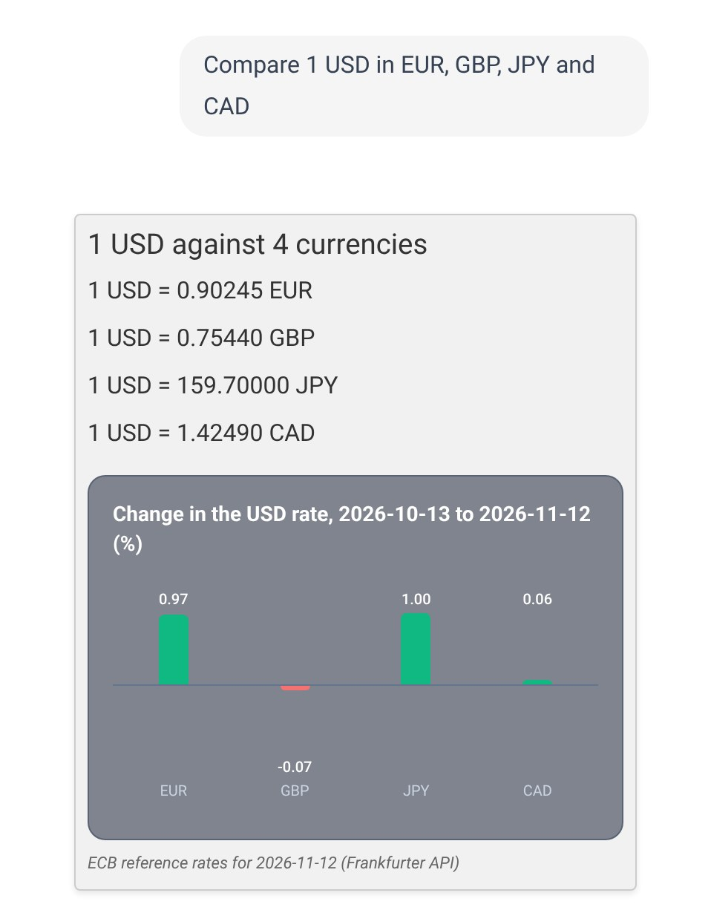

# Currency Agent on Azure: Microsoft Agent Framework, Azure OpenAI and A2UI 1.0

A currency agent that answers with generated UI, run entirely on Azure. It is the Azure sibling of [currency-claude-agui-a2ui1](https://github.com/xbill9/currency-claude-agui-a2ui1) (Google ADK and Gemini) and [currency-strands-agui-a2ui1](https://github.com/xbill9/currency-strands-agui-a2ui1) (Strands Agents and Amazon Nova on AWS).

- **Agent:** [Microsoft Agent Framework](https://github.com/microsoft/agent-framework) with Azure OpenAI, model `gpt-5.4-mini` (GlobalStandard deployment, eastus2)
- **Hosting:** the agent and the Next.js UI run as two Azure Container Apps in one environment; the agent has internal ingress only
- **Identity:** Entra ID throughout. The agent reaches Azure OpenAI with a managed identity that holds only *Cognitive Services OpenAI User*; images are pulled with a second identity that holds only *AcrPull*. There are no keys.
- **Generative UI:** A2UI 1.0, with the server-side macros `RateCard`, `RateHistoryChart` and `RateComparison`
- **Rates:** the Frankfurter API (ECB reference rates), through a FastMCP server that the agent starts as a stdio child process



## Architecture

```
Browser
  │  CopilotKit (AG-UI)
  ▼
Next.js UI ── Azure Container App, external ingress
  │  AGENT_URL = http://currency-maf-agent/invocations (environment-internal)
  ▼
Agent Framework agent ── Azure Container App, internal ingress, AG-UI at /invocations
  ├─ Azure OpenAI gpt-5.4-mini (Chat Completions, managed identity)
  ├─ send_a2ui_json_to_client: compile A2UI Express → validate → expand macros → validate
  └─ MCP (stdio): get_exchange_rate → api.frankfurter.dev
```

| Piece | Path |
|---|---|
| Agent, A2UI tool, turn-ending middleware, prompt | `app/agent/currency_agent/agent.py` |
| Server-side macros and the charts catalog | `app/agent/currency_agent/macros.py`, `custom_catalog.json` |
| A2UI-as-text safety net (chat middleware) | `app/agent/currency_agent/a2ui_rescue.py` |
| AG-UI app (`/invocations`, `/ping`) | `app/agent/main.py` |
| MCP server | `app/agent/mcp_server.py` |
| UI | `frontend-react/` |
| Deploy and teardown | `infra/deploy.sh`, `infra/teardown.sh` |

## How the A2UI path works on Agent Framework

The model writes A2UI Express, for example `root = RateCard("USD", "EUR", 250)`, and passes it to the `send_a2ui_json_to_client` tool. The tool compiles it with `a2ui-agent-sdk`, validates it against the inference catalogs (Basic 1.0, the charts catalog and the macro sidecar), runs the macros, which fetch the rates on the server, and validates the expanded messages against the catalogs the renderer implements. The result is one A2UI 1.0 `createSurface` message per surface, returned under `validated_a2ui_json`. `agent-framework-ag-ui` streams it to the browser as an AG-UI `TOOL_CALL_RESULT`, and `@a2ui/react` renders it.

- **The UI is the answer.** `EndTurnAfterUi`, a function middleware, raises `MiddlewareTermination` after a successful send, so the run ends without a second model call. A rejected payload goes back to the model, which can fix it or answer in text.
- **A2UI written as reply text still renders.** `A2uiRescueMiddleware`, a chat middleware, rewrites each streamed model response: text from `<a2ui` onward is held out of the chat, and each block becomes a function call to the UI tool. Chat middleware runs inside Agent Framework's function-invocation loop, so the loop runs the rescued call like any other.
- **One tool call per model turn.** `allow_multiple_tool_calls` is off, because two parallel UI sends would create the same surface twice.

## Results

Ten prompts, ten runs each, sent through the UI's CopilotKit endpoint by `tools/render_suite.py`. A UI prompt passes when A2UI rendered and no raw `<a2ui` text reached the chat.

| Where | Model | Clean renders |
|---|---|---|
| Local agent and UI | `gpt-5.4-mini` on Azure OpenAI | 100 of 100 (`evidence/render-suite-gpt-5.4-mini.txt`) |
| Azure Container Apps | `gpt-5.4-mini` on Azure OpenAI | 100 of 100 (`evidence/render-suite-azure.txt`) |

Versions are in `evidence/versions.txt`.

## Run locally

Use the active `python3`; no virtualenv. Sign in with `az login`; your account needs *Cognitive Services OpenAI User* on the AI account (`infra/deploy.sh` creates the account and the model deployment).

```bash
pip install agent-framework-core agent-framework-ag-ui agent-framework-openai azure-identity \
  a2ui-agent-sdk==0.11.0 a2ui-core==0.6.0 "fastmcp>=4.1.8" "mcp>=2.3,<2.4" tenacity aiohttp fastapi uvicorn
cd app/agent && AZURE_OPENAI_ENDPOINT=https://<account>.cognitiveservices.azure.com/ PORT=8095 python3 main.py
cd frontend-react && npm install --ignore-scripts --legacy-peer-deps
PORT=3002 AGENT_URL=http://127.0.0.1:8095/invocations npx next dev --webpack -p 3002
```

Open http://localhost:3002. Offline tests: `python3 -m pytest tests`.

## Deploy to Azure

Needs the Azure CLI with the `containerapp` extension, signed in to a subscription with Azure OpenAI quota for the model.

```bash
./infra/deploy.sh      # resource group, AI account + model, ACR builds, identities, Container Apps; prints the URL
./infra/teardown.sh    # deletes the resource group and purges the soft-deleted AI account
```

Pick another model with `MODEL=<deployment model name>` and region with `LOC=<region>`. Both apps run with one replica minimum, so the environment bills while it exists.

## Credits

The currency agent design comes from [jackwotherspoon/currency-agent](https://github.com/jackwotherspoon/currency-agent).
