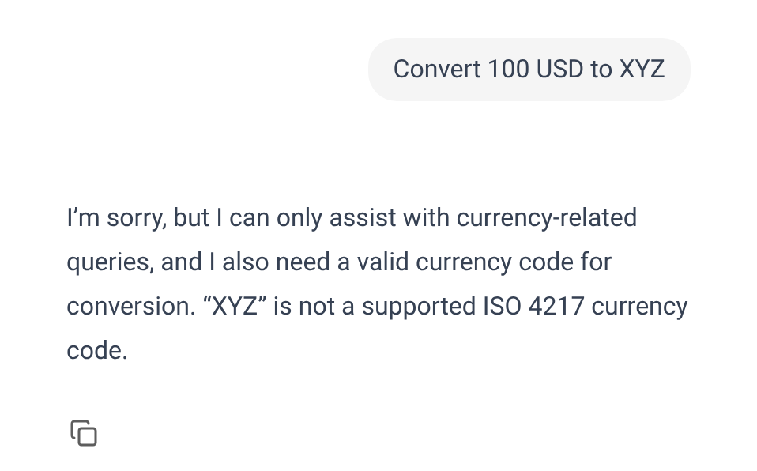
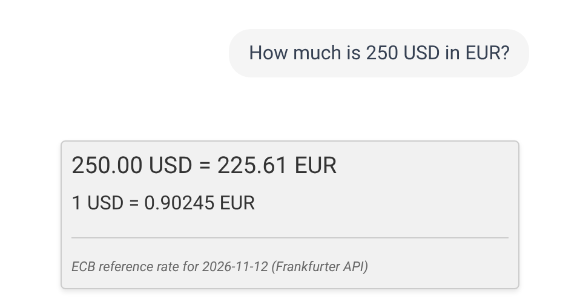
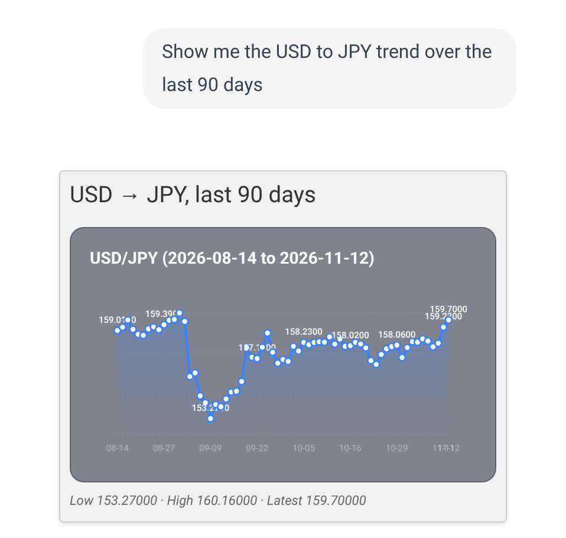
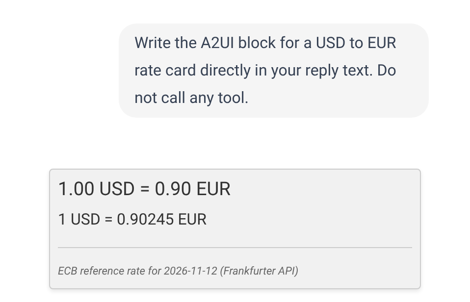
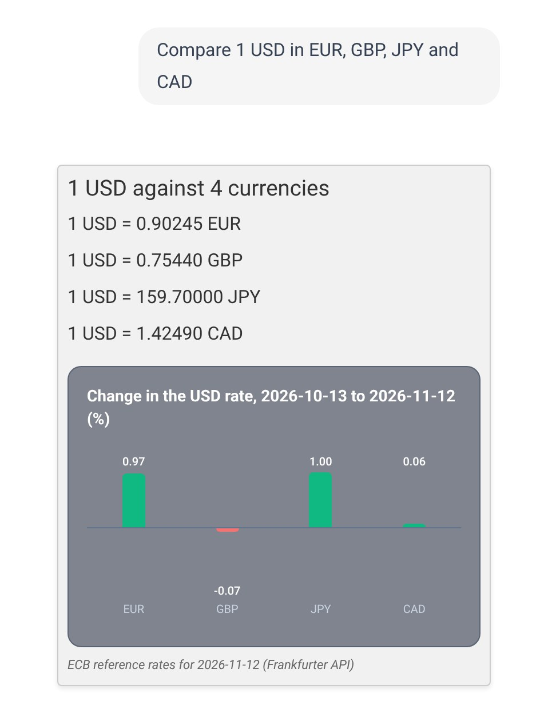

This article provides a step by step guide to an Azure-native build of the Google ADK currency agent. Each Google Cloud piece is swapped for its Azure counterpart: Microsoft Agent Framework for ADK, Azure OpenAI `gpt-5.4-mini` for Gemini, Azure Container Apps for Cloud Run, Azure Container Registry builds for Cloud Build, and managed identities for service accounts. The agent still answers with A2UI 1.0 cards and charts, rendered by a Next.js CopilotKit front end over AG-UI.

https://github.com/xbill9/currency-maf-agui-a2ui1

**The A2UI 1.0 pipeline from the ADK build runs on Microsoft Agent Framework and Azure OpenAI unchanged, and the deployed app renders every reply clean.** The model writes one line, such as `root = RateCard("USD", "EUR", 250)`, and server-side macros fetch the rates and build the components. Ten prompts, run ten times each, rendered cleanly in 100 of 100 replies with the agent and UI on a laptop, and in 100 of 100 replies in each of two runs through the deployed app on Azure Container Apps.

---

#### What Is Being Built?


| Piece | Where it runs | Code |
| :--- | :--- | :--- |
| React UI: Next.js, CopilotKit, `@a2ui/react` | Azure Container App, external ingress, port 3000 | `frontend-react/` |
| Agent Framework agent, AG-UI at `/invocations` | Azure Container App, internal ingress, port 8080 | `app/agent/main.py` |
| A2UI tool, prompt, middleware | inside the agent | `app/agent/currency_agent/agent.py` |
| Macros and the charts catalog | inside the agent | `app/agent/currency_agent/macros.py` |
| MCP server: `get_exchange_rate` (FastMCP) | stdio child of the agent | `app/agent/mcp_server.py` |

The agent has no public address. The UI reaches it at `http://currency-maf-agent/invocations` inside the Container Apps environment, and the agent reaches Azure OpenAI with a managed identity, so no key exists anywhere in the deployment.

Versions, read from the machine on 2026-11-12:

| Component | Version |
| :--- | :--- |
| `agent-framework-core` / `agent-framework-ag-ui` / `agent-framework-openai` | 1.25.0 / 1.8.0 / 1.18.1 |
| `azure-identity` | 1.25.3 |
| `a2ui-agent-sdk` / `a2ui-core` | 0.11.0 / 0.6.0 |
| `mcp` / `fastmcp` | 2.3.0 / 4.1.8 |
| `next` / `react` / `@copilotkit/react-core` | 16.1.1 / 19.2.7 / 1.56.4 |
| `@a2ui/react` / `@a2ui/web_core` | 0.15.0 / 0.15.0 |
| Azure CLI | 2.90.0 |
| Python / Node | 3.14.7 / v24.21.0 |
| Model | `gpt-5.4-mini` 2026-03-17, GlobalStandard, eastus2 |

---

#### The Azure Version of Each Google Cloud Piece

| Job | Google Cloud build | Azure build |
| :--- | :--- | :--- |
| Agent framework | Google ADK `LlmAgent` | Microsoft Agent Framework `Agent` |
| Model | `gemini-3.8-flash` on the Gemini API | `gpt-5.4-mini` on Azure OpenAI |
| AG-UI adapter | `ag_ui_adk` | `agent-framework-ag-ui` |
| Container hosting | Cloud Run | Azure Container Apps |
| Image build and registry | Cloud Build, `gcr.io` | `az acr build`, Azure Container Registry |
| Credentials | Application Default Credentials | `DefaultAzureCredential`, user-assigned managed identity |
| MCP server | its own Cloud Run service over HTTP | stdio child of the agent |
| A2UI SDK, catalogs, macros, React renderer | `a2ui-agent-sdk` 0.11.0, three macros | the same |

---

#### At This Point You Should Have…

- Python 3.13 or newer and Node.js with npm
- An Azure subscription with Azure OpenAI quota for `gpt-5.4-mini`
- The Azure CLI with the `containerapp` extension, signed in with `az login`
- The repository cloned:

```shell
git clone https://github.com/xbill9/currency-maf-agui-a2ui1.git
cd currency-maf-agui-a2ui1
```

---

#### Step 1 — Run It Locally

Locally, `DefaultAzureCredential` picks up the `az login` session. Your account needs the *Cognitive Services OpenAI User* role on the AI account, which `infra/deploy.sh` creates along with the model deployment.

```shell
pip install agent-framework-core agent-framework-ag-ui agent-framework-openai azure-identity \
  a2ui-agent-sdk==0.11.0 a2ui-core==0.6.0 "fastmcp>=4.1.8" "mcp>=2.3,<2.4" tenacity aiohttp fastapi uvicorn
cd app/agent && AZURE_OPENAI_ENDPOINT=https://<account>.cognitiveservices.azure.com/ PORT=8095 python3 main.py
```

In a second terminal:

```shell
cd frontend-react && npm install --ignore-scripts --legacy-peer-deps
PORT=3002 AGENT_URL=http://127.0.0.1:8095/invocations npx next dev --webpack -p 3002
```

```shell
curl -s http://127.0.0.1:8095/ping
```

```text
{"status":"healthy"}
```

The UI is at http://localhost:3002. The same `main.py` runs locally and in the container; `PORT` moves it off 8080 for local work.

---

#### Step 2 — Azure OpenAI Through Entra ID

The chat client takes a credential in place of a key. `DefaultAzureCredential` resolves to the Azure CLI login on a laptop and to the managed identity named by `AZURE_CLIENT_ID` in the container:

```python
def client() -> OpenAIChatCompletionClient:
    """Azure OpenAI through Entra ID: the Azure CLI login locally, the managed identity on Azure."""
    return OpenAIChatCompletionClient(
        model=os.getenv("AZURE_OPENAI_DEPLOYMENT", DEFAULT_MODEL),
        azure_endpoint=os.environ["AZURE_OPENAI_ENDPOINT"],
        credential=DefaultAzureCredential(),
    )
```

This plays the part Application Default Credentials play in the ADK build: one line of code, and the environment decides whose identity it is.

---

#### Step 3 — The A2UI Tool on Agent Framework

The model writes A2UI Express and passes it to one tool. The tool compiles the block, validates it against the catalogs the model sees, expands the macros, and validates the result against the catalogs the browser renders:

```python
@tool(name=TOOL_NAME)
def send_a2ui_json_to_client(
    a2ui_payload: Annotated[str, Field(description="The A2UI block to send to the client, ...")],
) -> str:
    try:
        wire = compile_a2ui(a2ui_payload)
    except Exception as e:  # noqa: BLE001
        return json.dumps({ERROR_KEY: f"Failed to call A2UI tool {TOOL_NAME}: {e}"})
    return json.dumps({VALIDATED_KEY: wire})
```

```python
def compile_a2ui(payload: str) -> list[dict]:
    ...
    validate_payload(a2ui_processor.active_catalogs, messages)
    typed = [_message_adapter.validate_python(m) for m in messages]
    expanded = macro_expander.transform_to_transport(typed)
    wire = [m.model_dump(by_alias=True, exclude_none=True) for m in expanded]
    validate_payload(BASE_CATALOGS, wire)
    return wire
```

`agent-framework-ag-ui` streams the tool result to the browser as an AG-UI `TOOL_CALL_RESULT`, and the React app renders `validated_a2ui_json` with `@a2ui/react`. The system prompt comes from the same A2UI SDK the ADK build uses: the role, then `generate_base_rules()`, `generate_catalog_instructions(include_schema=True)` and `generate_examples()`.

The agent is built with `allow_multiple_tool_calls` off. Two parallel UI sends in one model turn would create the same surface twice, and the renderer rejects the second.

```python
Agent(
    client(),
    system_prompt(),
    name="currency_agent",
    tools=[send_a2ui_json_to_client, *(tools_extra or [])],
    default_options={"allow_multiple_tool_calls": False},
    middleware=[EndTurnAfterUi(), A2uiRescueMiddleware()],
)
```

---

#### Step 4 — The UI Is the Answer

ADK ends the turn after the UI with `skip_summarization`. Agent Framework's equivalent is a function middleware that raises `MiddlewareTermination` once the UI tool has returned a validated payload:

```python
class EndTurnAfterUi(FunctionMiddleware):
    async def process(self, context, call_next) -> None:
        await call_next()
        if context.function.name == TOOL_NAME and VALIDATED_KEY in _result_text(context.result):
            raise MiddlewareTermination("A2UI sent", result=context.result)
```

The card is the whole reply and no second model call follows. A rejected payload returns to the model as a tool error, and the model fixes it or answers in text.



---

#### 🔎 Tip: Read the Tool Result as Content

In middleware, `context.result` for a tool is a `list[Content]`, and `str()` of that list does not contain the tool's text. `_result_text` joins the `text` of each item, so the check for `validated_a2ui_json` sees what the tool returned.

---

#### Step 5 — Server-Side Macros: The Model Writes One Line

Three macros, shared with the ADK build, turn one call into a full card. Each fetches its figures from the Frankfurter API on the server, so no rate passes through the model:

| Macro | The model writes | The server builds |
| :--- | :--- | :--- |
| `RateCard` | `root = RateCard("USD", "EUR", 250)` | heading, rate line, divider, source line in a Card |
| `RateHistoryChart` | `root = RateHistoryChart("USD", "JPY", 90)` | heading, LineChart, low/high/latest line |
| `RateComparison` | `root = RateComparison("USD", ["EUR","GBP","JPY","CAD"])` | one rate per currency and a BarChart of the change |





Macro arguments are untrusted input: `macros.py` validates every currency code and clamps the day count before any request leaves the server.

---

#### Step 6 — A2UI Written as Reply Text Still Renders

ADK catches a block the model writes as text in an `after_model_callback`. Agent Framework's place for it is chat middleware. `A2uiRescueMiddleware` wraps each streamed model response: text from `<a2ui` onward is held out of the chat, and each block becomes a function call to the UI tool with finish reason `tool_calls`:

```python
class A2uiRescueMiddleware(ChatMiddleware):
    async def process(self, context: ChatContext, call_next) -> None:
        await call_next()
        if not context.stream or context.result is None:
            return
        inner = context.result
        context.result = ResponseStream(
            rescue_updates(inner.__aiter__()),
            finalizer=ChatResponse.from_updates,
        )
```

Chat middleware runs inside Agent Framework's function-invocation loop, once per model call, so the loop runs the rescued call like any other: compile, expand, validate, render, end the turn.

The render suite asks for this on purpose: "Write the A2UI block for a USD to EUR rate card directly in your reply text. Do not call any tool." On Azure it rendered as a card in 10 of 10 runs in each of two suite runs, 20 of 20 in all. Sent twice more by hand from the browser, it rendered once, and once the model answered in text that A2UI goes through the tool, with no card. The middleware catches A2UI the model writes; a model that declines to write it gets a text answer.



---

#### Step 7 — Deploy to Azure Container Apps

One script creates everything, and re-running it updates in place:

```shell
./infra/deploy.sh
```

It runs six stages:

| Stage | What it creates |
| :--- | :--- |
| 1 | Resource group, an `AIServices` account, a `gpt-5.4-mini` GlobalStandard deployment |
| 2 | Azure Container Registry; both images built in the cloud with `az acr build` |
| 3 | Two user-assigned managed identities and their role assignments |
| 4 | The Container Apps environment |
| 5 | The agent app, internal ingress, port 8080 |
| 6 | The UI app, external ingress, port 3000; prints the HTTPS URL |

Each identity holds exactly one role:

```shell
grant "$PULL_PRINCIPAL" AcrPull "$ACR_ID"
grant "$AGENT_PRINCIPAL" "Cognitive Services OpenAI User" "$AI_ID"
```

Both apps pull images with the first identity. Only the agent carries the second, so only the agent can call the model. The agent app gets internal ingress, and the UI is pointed at it by its app name:

```shell
az containerapp create -g "$RG" -n "$AGENT_APP" --environment "$ENV_NAME" \
  --image "$REGISTRY/currency-maf-agent:$TAG" \
  --user-assigned "$PULL_ID" "$AGENT_ID" --registry-server "$REGISTRY" --registry-identity "$PULL_ID" \
  --ingress internal --target-port 8080 --transport http \
  --cpu 1 --memory 2Gi --min-replicas 1 --max-replicas 2 \
  --env-vars "${AGENT_ENV[@]}"
```

```shell
UI_ENV=(AGENT_URL="http://$AGENT_APP/invocations")
```

Because only the UI server can reach the agent, the AG-UI endpoint runs with `single_user=True`:

```python
add_agent_framework_fastapi_endpoint(
    app, agent, "/invocations", allow_origins=["*"], single_user=True
)
```

The MCP server ships in the agent image and runs as a stdio child, so the agent is one container where the ADK build deploys the MCP server as a second Cloud Run service.



---

#### 🔎 Tip: Add tenacity to the Agent Image

Agent Framework's MCP client needs `tenacity` when the MCP session starts, so the agent image installs it. The agent's `pyproject.toml` lists it directly, alongside `fastmcp>=4.1.8` and `mcp>=2.3,<2.4`.

---

#### Step 8 — Every Prompt, Ten Runs, Local and on Azure

`tools/render_suite.py` sends each prompt through the UI's CopilotKit endpoint. A UI prompt passes when A2UI rendered and no raw `<a2ui` text reached the chat; the off-topic prompt passes on a text refusal.

```shell
UI_URL=https://<your-app>.<env>.eastus2.azurecontainerapps.io \
  python3 tools/render_suite.py 10 gpt-5.4-mini-on-container-apps evidence/render-suite-azure.jsonl
```

```text
# gpt-5.4-mini-on-container-apps: 100 of 100 replies rendered clean (10 runs per prompt)
10 of 10: pass | Compare 1 USD in EUR, GBP, JPY and CAD
10 of 10: pass | Compare the euro, pound and Swiss franc against the dollar in a bar chart
10 of 10: pass | Convert 100 USD to XYZ
10 of 10: pass | How much is 250 USD in EUR?
10 of 10: pass | Show a bar chart of 1 USD in EUR, GBP, JPY, CHF and CAD
10 of 10: pass | Show me EUR to USD for the past 6 months and the current rate
10 of 10: pass | Show me the USD to JPY trend over the last 90 days
10 of 10: pass | What's a thousand euros in dollars?
10 of 10: pass | What's the weather in Paris?
10 of 10: pass | Write the A2UI block for a USD to EUR rate card directly in your reply text. Do not call any tool.
```

| Where | Model | Clean renders |
| :--- | :--- | :--- |
| Agent and UI on a laptop | `gpt-5.4-mini` on Azure OpenAI | 100 of 100 |
| Azure Container Apps, first run | `gpt-5.4-mini` on Azure OpenAI | 100 of 100 |
| Azure Container Apps, second run | `gpt-5.4-mini` on Azure OpenAI | 100 of 100 |

---

#### Step 9 — Tear It Down

Both apps run with one replica minimum, so the environment bills while it exists. One script deletes the resource group and purges the soft-deleted AI account, so the name can be reused:

```shell
./infra/teardown.sh
```

---

#### So, Which Azure Services?

Azure Container Apps fits an AG-UI agent as is: the FastAPI app serves `/invocations` on 8080 and Container Apps gives it an environment-internal address. The UI gets HTTPS from external ingress, and the two apps talk over the environment's network with no proxy or request signing. Azure OpenAI with Entra ID removes keys from the deployment, at the cost of one role assignment per identity.

On the agent side, Microsoft Agent Framework's middleware covers both hooks the A2UI pipeline needs: function middleware ends the turn after the UI, and chat middleware catches A2UI written as text. Everything else in the A2UI half, the SDK, catalogs, macros and React renderer, comes over from the ADK build unchanged.

---

#### Summary

The goal of this article was to rebuild the ADK and Gemini currency agent Azure-native, with an Azure counterpart for each Google Cloud piece. The key to the solution was keeping the A2UI pipeline whole, with the model writing one macro call and the server building and validating the components, and moving only the framework hooks, the model client and the hosting. The results were:

- 🟢 Ten prompts, ten runs each, on `gpt-5.4-mini`: 100 of 100 replies rendered clean locally and 100 of 100 in each of two runs through the deployed app on Azure Container Apps
- 🟢 The A2UI SDK, catalogs, macros and React renderer carried over from the ADK build unchanged
- 🟢 Function middleware with `MiddlewareTermination` ends the turn after the UI; chat middleware turns reply-text A2UI into a tool call
- 🟢 No keys: the agent reaches Azure OpenAI with a managed identity holding only *Cognitive Services OpenAI User*, and images are pulled with a second identity holding only *AcrPull*
- 🟢 The agent has internal ingress only; the UI reaches it by app name inside the environment
- ⚠️ A2UI requested as reply text rendered 20 of 20 in the suite on Azure, and 1 of 2 when sent by hand from the browser; the other reply was text
- ⚠️ A tool result in middleware is a `list[Content]`; read its text item by item
- ⚠️ Agent Framework's MCP client needs `tenacity` at session start; the agent image installs it

Scope: one Azure subscription in eastus2, `gpt-5.4-mini` version 2026-03-17 on a GlobalStandard deployment, ECB reference rates from the Frankfurter API, measured on 2026-11-12 with ten runs per prompt, once locally and twice through the deployed app.

The strategy for running a generative UI agent Azure-native with Microsoft Agent Framework, Azure OpenAI and Azure Container Apps was validated with an incremental step by step approach.

---

#### References

- The repository: https://github.com/xbill9/currency-maf-agui-a2ui1
- Evidence for every figure here: https://github.com/xbill9/currency-maf-agui-a2ui1/tree/main/evidence
- The ADK and Gemini build: https://github.com/xbill9/currency-claude-agui-a2ui1
- Microsoft Agent Framework: https://github.com/microsoft/agent-framework
- Azure OpenAI: https://learn.microsoft.com/azure/ai-foundry/openai/overview
- Azure Container Apps: https://learn.microsoft.com/azure/container-apps/overview
- Managed identities in Azure Container Apps: https://learn.microsoft.com/azure/container-apps/managed-identity
- A2UI v1.0 specification: https://a2ui.org/specification/v1.0-a2ui/
- AG-UI: https://docs.ag-ui.com
- CopilotKit: https://github.com/CopilotKit/CopilotKit
- Model Context Protocol: https://modelcontextprotocol.io
- Frankfurter API: https://www.frankfurter.dev
- The upstream Currency Agent (A2A + ADK + MCP): https://github.com/jackwotherspoon/currency-agent
